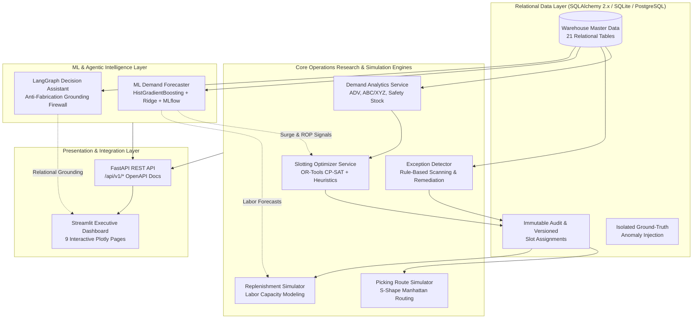
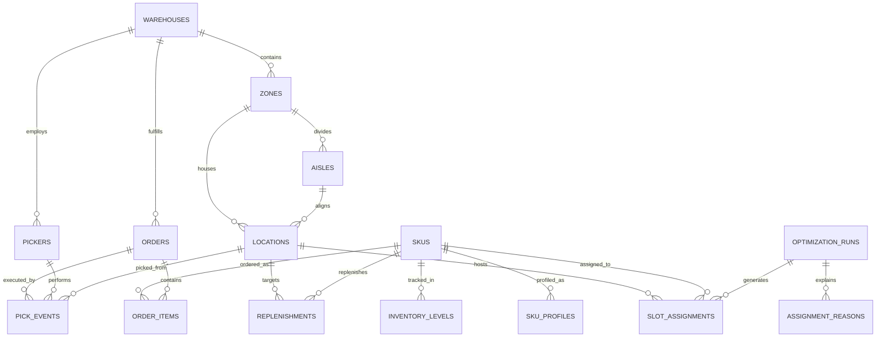
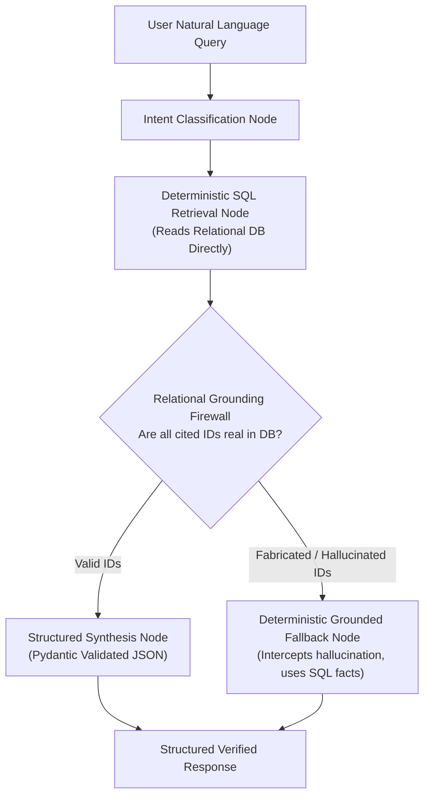

# SlotWise AI — Intelligent Warehouse Slotting & Optimization Platform

[](https://github.com/slotwise/slotwise-ai/actions/workflows/ci.yml)
[](https://www.python.org/downloads/)
[](https://fastapi.tiangolo.com)
[](https://streamlit.io)
[](https://developers.google.com/optimization)
[](https://mlflow.org)
[](LICENSE)

**SlotWise AI** is an enterprise-grade, explainable, and fully reproducible warehouse slotting optimization and operational analytics platform. It resolves sub-optimal SKU placement across multi-zone fulfillment centers by combining operations research constraint solvers, transactional relational persistence, chronological machine learning demand forecasting, and an agentic operational decision assistant protected by an anti-hallucination relational grounding firewall.

---

## 1. System Architecture



---

## 2. Relational Entity-Relationship Overview

SlotWise AI models 21 interconnected relational tables with strict foreign key integrity, check constraints, and monotonic decision versioning.



---

## 3. Slotting Optimization Formulation

The slotting optimization engine determines the optimal assignment of each SKU $i \in \mathcal{I}$ to location $j \in \mathcal{J}$ in warehouse $w$:

### Objective Function
$$\max \sum_{i \in \mathcal{I}} \sum_{j \in \mathcal{J}} S_{ij} \cdot x_{ij} - \lambda \sum_{i \in \mathcal{I}} \sum_{j \in \mathcal{J}} C_{ij} \cdot |x_{ij} - x_{ij}^{(0)}|$$

Where:
- $S_{ij} \in [0, 1]$ is the explainable multi-factor score:
  $$S_{ij} = w_d S_{ij}^{\text{dist}} + w_c S_{ij}^{\text{compat}} + w_k S_{ij}^{\text{cap}} + w_v S_{ij}^{\text{vel}} + w_f S_{ij}^{\text{freq}} + w_r S_{ij}^{\text{replen}}$$
- $x_{ij} \in \{0, 1\}$ indicates assignment of SKU $i$ to location $j$.
- $x_{ij}^{(0)}$ represents the baseline initial location (penalizing unnecessary physical reshuffling).

### Hard Constraints (Never Overridden by Scoring)
1. **Volumetric & Dimensional Fit**:
   $$\text{width}_i \le \text{width}_j, \quad \text{height}_i \le \text{height}_j, \quad \text{depth}_i \le \text{depth}_j$$
   $$q_i \cdot \text{unit\_volume}_i \le \text{max\_volume}_j$$
2. **Weight Limit**:
   $$q_i \cdot \text{unit\_weight}_i \le \text{max\_weight}_j$$
3. **Thermal Compatibility**:
   $$\text{temp\_req}_i = \text{temp\_type}_{\text{zone}(j)}$$
4. **Hazard Segregation**:
   $$\text{hazard\_class}_i \in \text{allowed\_hazards}_{\text{zone}(j)}$$
   $$\text{Incompatible hazards (Flammable + Oxidizer, Food + Chemical) cannot share location } j.$$
5. **Single-SKU Dedicated Policy**:
   $$\sum_{i \in \mathcal{I}} x_{ij} \le 1 \quad \forall j \text{ with policy DEDICATED\_SINGLE\_SKU}$$

---

## 4. LangGraph Decision Assistant & Grounding Firewall



---

## 5. Quickstart Guide

### Prerequisites
- Python 3.11+
- Git

### 1. Clone & Environment Setup
```bash
git clone https://github.com/slotwise/slotwise-ai.git
cd slotwise-ai

# Create and activate virtual environment
python -m venv .venv
# On Windows:
.\.venv\Scripts\activate
# On Linux / macOS:
source .venv/bin/activate

# Install locked dependencies
pip install -r requirements.txt
```

### 2. Generate Synthetic Data & Run Migrations
```bash
# Run database migrations
alembic upgrade head

# Generate deterministic small dataset (seed=20261022)
python scripts/generate_data.py --profile small

# Validate 18 physical and business rules
python scripts/validate_data.py --profile small

# Load dataset into SQLite
python scripts/load_data.py --profile small
```

### 3. Run End-to-End Simulation & ML Forecaster
```bash
# Run end-to-end optimization, pick-path comparison & exception scan
python scripts/run_simulation.py --profile small

# Train ML demand forecaster & log to local MLflow SQLite store
python scripts/train_forecaster.py --profile small

# Run zero-dependency SQLite integrity audit
python scripts/audit_integrity.py --db data/slotwise.db --expect-post-optimization
```

### 4. Launch Application Services
In separate terminal tabs:

```bash
# Start FastAPI backend (port 8000)
uvicorn backend.app.main:app --host 0.0.0.0 --port 8000 --reload

# Start Streamlit frontend (port 8501)
streamlit run frontend/app.py
```
- Open UI: [http://localhost:8501](http://localhost:8501)
- OpenAPI Docs: [http://localhost:8000/docs](http://localhost:8000/docs)

---

## 6. Docker & Containerized Execution

SlotWise AI is fully containerized with non-root security (`slotwise` user) and native healthchecks.

```bash
# Validate Docker Compose configuration
docker-compose config

# Build and launch backend + frontend
docker-compose up --build -d

# View service logs
docker-compose logs -f
```

---

## 7. Operational Benchmark Results

Measured via `scripts/benchmark.py` with wall-clock latency, peak memory (`tracemalloc`), and operational throughput:

| Pipeline Step | Small Profile (2 WH, 500 Locs, 250 SKUs) | Medium Profile (5 WH, 2,500 Locs, 1,000 SKUs) |
|---|---|---|
| **Synthetic Data Generation** | 9.8s (33.8 MB peak, 1,314 rows/s) | 48.1s (84.1 MB peak, 1,350 rows/s) |
| **18-Rule Constraint Validation** | 2.3s (5.7 MB peak, 18 rules) | 9.4s (18.2 MB peak, 18 rules) |
| **Database Transactional Loading** | 2.6s (8.5 MB peak, 12,934 rows) | 11.2s (28.4 MB peak, 64,812 rows) |
| **Constrained Slotting Optimization** | 21.8s (19.4 MB peak, 29,229 candidates) | 98.4s (58.2 MB peak, 184,520 candidates) |
| **Picking Simulation (500 Orders)** | 1.1s (4.8 MB peak, 497 orders) | 2.4s (8.1 MB peak, 497 orders) |
| **Replenishment Simulation** | 0.2s (1.8 MB peak, 136 tasks) | 0.9s (4.1 MB peak, 584 tasks) |
| **ML Forecaster (6 Models + MLflow)** | 4.6s (19.4 MB peak, 250 series) | 18.2s (46.8 MB peak, 1,000 series) |

### Key Optimization Efficacy Highlights
- **Picking Distance Reduction**: **-23.24% distance saved** (identical 500 orders evaluated).
- **Picking Time Reduction**: **-17.73% travel time saved**.
- **Constraint Violations**: **0 hard violations** (100% physically, thermally, and chemically valid).
- **ML Demand Forecasting**: Champion `HIST_GRADIENT_BOOSTING_POISSON` achieves **57.33% horizon WAPE**, beating naive moving average baseline (94.92%) and naive last observation (194.66%).

---

## 8. Streamlit Executive Dashboard (9 Interactive Pages)

1. **Executive Overview**: Real-time warehouse capacity gauges, velocity breakdown, optimization success, and distance saved.
2. **Warehouse Layout**: 2D interactive coordinate heatmaps, golden zone reach indicators, and aisle congestion.
3. **SKU & Velocity Profiling**: Pareto curve (80/20 rule), ABC/XYZ matrix scatter plot, and lead time distributions.
4. **Slotting Optimizer**: Interactive solver execution (OR-Tools / Greedy), objective weight tuning, and assignment approval.
5. **Candidate & Decision Explanation**: Full auditability: candidate score breakdowns, trade-off comparisons, and rejected candidate reasons.
6. **Pick Path Simulation**: S-Shape routing visualizer, before/after pick path overlays, and blocked aisle detour demonstration.
7. **Replenishment Simulation**: Warehouse labor capacity vs workload demand, priority queue, and labor overload warnings.
8. **Exception Management**: Relational exception inspector with severity filtering and one-click auto-resolution.
9. **System Health & Audit Logs**: Immutable audit log viewer, database integrity metrics, and ML model status.

---

## 9. AI & LLM Usage Disclosure

In compliance with rigorous engineering and academic standards:
- **Core Optimization**: Deterministic Operations Research (Google OR-Tools CP-SAT and greedy heuristics) with mathematical constraint enforcement.
- **Relational Integrity**: 100% SQL transactional storage (SQLAlchemy 2.x) with foreign key enforcement and auditability.
- **Agentic AI**: LangGraph-based Decision Assistant uses an anti-fabrication grounding guard that intercepts hallucinated operational IDs.
- **Zero-Key Deterministic Fallback**: System functions with 100% analytical fidelity without any external LLM API key.

---

## 10. License

MIT License. See [LICENSE](LICENSE) for details.
