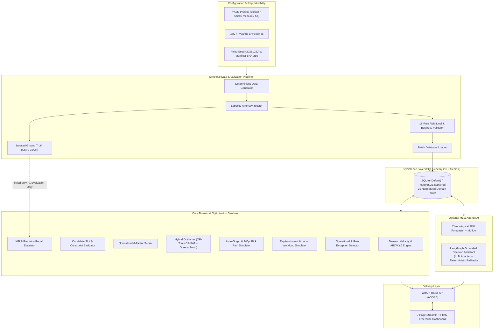
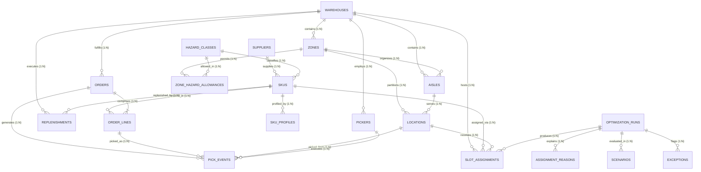
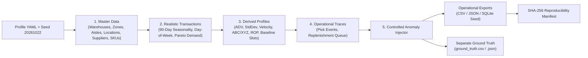
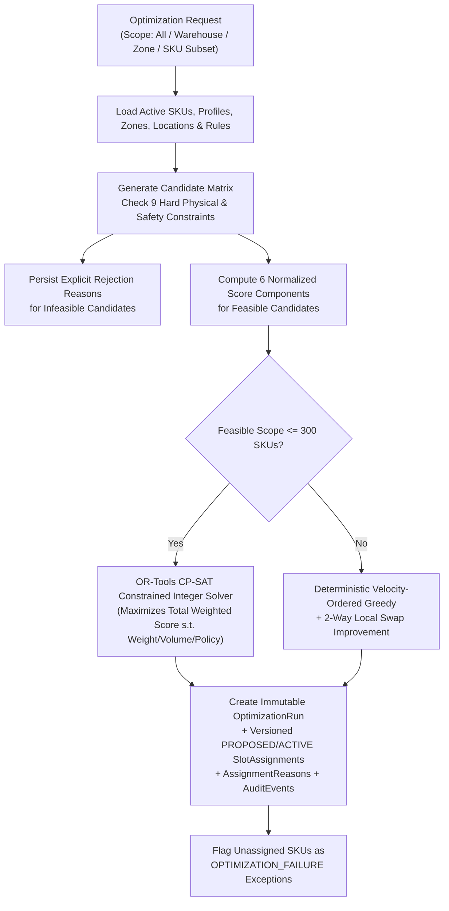
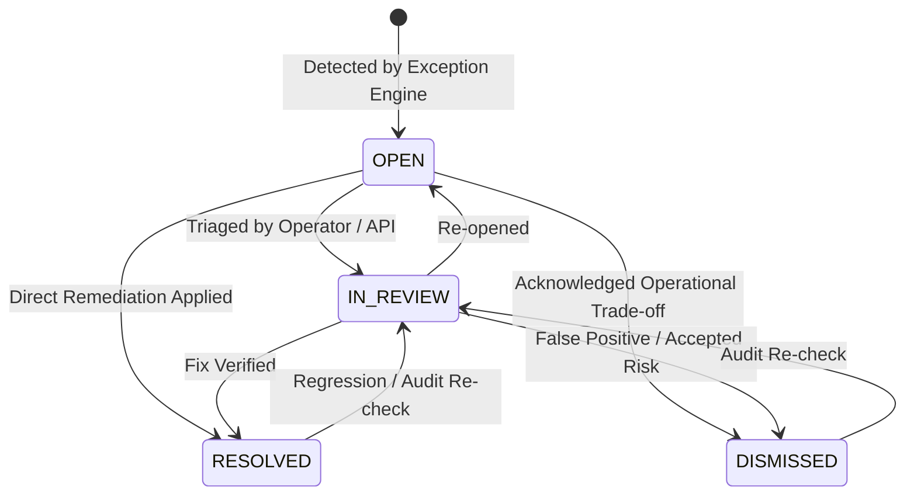
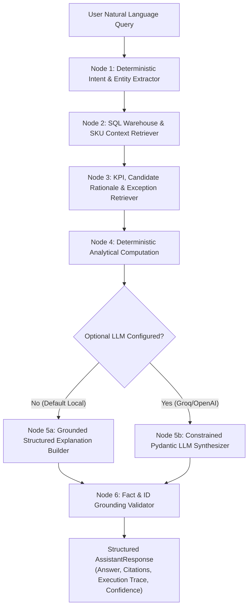

# SlotWise AI — System Architecture

## 1. Architectural Overview

**SlotWise AI** is a modular, deterministic, production-inspired warehouse slotting optimization and operational analytics platform. Every component—synthetic data pipelines, relational storage, demand analytics, candidate generation, constrained optimization, pick-path routing, replenishment simulation, exception detection, ML demand forecasting, LangGraph decision support, FastAPI REST endpoints, and the 9-page Streamlit dashboard—operates over a **single shared relational domain model**.

### Design Principles

1. **Zero Paid / External Dependencies for Core Execution**: Runs locally on Python 3.12 + SQLite (with WAL & strict Foreign Keys enabled) and supports drop-in PostgreSQL switching via `SLOTWISE_DATABASE_URL`.
2. **Hard Constraints Before Soft Scores**: Multi-factor scoring ranks feasible slots only; physical dimensions, weight/volume capacity, hazard allowances, temperature compatibility, co-location rules, and unblocked status are non-negotiable hard constraints.
3. **Immutable Historical Traceability**: Optimization runs (`optimization_runs`), versioned slot assignments (`slot_assignments`), evaluated candidate rationales (`assignment_reasons`), and state changes (`audit_events`) are append-only / lifecycle-versioned. Historical assignments are never overwritten.
4. **Strict Ground-Truth Isolation**: Injected anomalies are recorded in `data/ground_truth/` exclusively for precision/recall/F1 evaluation. Operational tables, exception detectors, and ML feature pipelines never read ground-truth columns.

---

## 2. System Component Architecture

---

## 3. Entity-Relationship Diagram

---

## 4. Data Generation & Ground-Truth Separation Pipeline

---

## 5. Slotting Optimization Workflow

---

## 6. Exception Lifecycle State Machine

---

## 7. LangGraph Warehouse Decision Assistant Workflow

